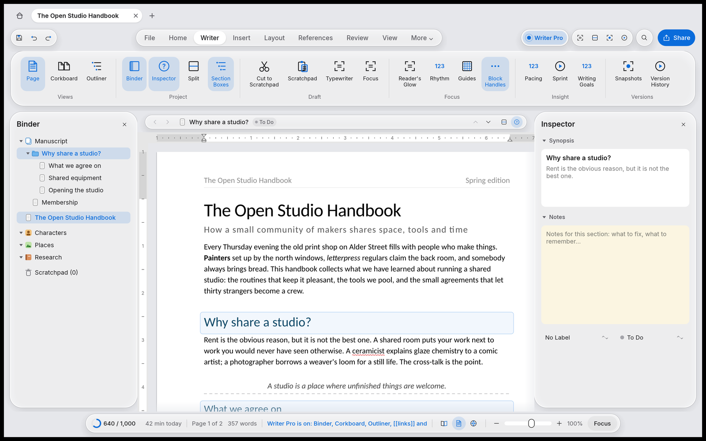

<h1 align="center">WordCraft Plus</h1>

<p align="center">
  <b>A New features added to the  <a href="https://github.com/storytold/wordcraft">WordCraft</a>, with a Writer Pro mode for long-form writing.</b>
</p>

<p align="center">
  Word's ribbon and documents, a calm Apple-style interface, and the writing tools of Scrivener,
  Notion and Obsidian, in one native Rust app.
</p>

<p align="center">
  
  
  
  
</p>

<p align="center">
  
</p>

---

## What this is

**WordCraft Glass** is a separate front end built on top of
[WordCraft](https://github.com/storytold/wordcraft), the open-source, clean-room Rust word
processor by the ArtCraft team. WordCraft provides the document engine (layout, `.docx` I/O,
styles, tables, track changes, references) and its own classic, Word-style interface.

Plus replaces not only the window around the page. It lives in its own crate
(`crates/ui-glass`) and app (`apps/wordcraft-glass`), uses WordCraft's public building blocks,
and **does not change the original interface**, which keeps working unchanged
(`cargo run -p wordcraft`).

It is an independent project and is not affiliated with or endorsed by ArtCraft or Microsoft.

## Features

### Interface

- **Liquid Glass design**, after Apple's: floating glass cards (shadow, translucent fill, inner
  highlight, darker edge), capsule controls, and motion everywhere (sliding tab pill, fading tab
  content, animated switches and panels). Light, dark and automatic.
- **Mac-style toolbar**: Quick Access, the tabs as a segmented control, writing tools, command
  search and Share on one line. On macOS the tab bar sits beside the traffic lights.
- **The complete ribbon**: Home, Insert, Layout, References, Review and View, with
  Draw, Design, Mailings, Developer, Zotero and Help under **More**. Every group, gallery, split
  button, dialog launcher and Alt key tip from WordCraft's ribbon works. One row that scrolls
  sideways when the window is narrow.
- **Document tabs**, as in Notion or Safari: a Home tab, one tab per document, live page
  previews on hover, ⌘T for a new tab, ⌃Tab to move between tabs. Each tab keeps its own undo,
  scroll and versions, and closing an edited one asks first.
- **Home page**: today's writing goal, the week at a glance, templates (blank, handbook, letter,
  résumé, report), recent files, and the Writer Pro switch.
- **Side panels** that slide in, **resize** by dragging their edge (saved, with sensible
  limits).
- **Navigation pane** with headings and real page thumbnails.
- **Appearance panel**: theme, seven accent colours, four window tones, glass tint, Reduce
  Transparency, interface size, animations, dark page, and every writing aid below.

### Writing aids (for everyone)

- **Writing goals**: a daily word goal ring, minutes writing, streak, and the last seven days.
- **Snapshots** with names, a preview of what changed, and Restore; **version history** with an
  automatic version every ten minutes.
- **Typewriter mode**: the line you are writing glides to the middle of the window and the rest
  of the page fades softly into the paper (light and dark).
- **Reader's Glow**: everything but the paragraph or sentence you are writing fades back.
- **Rhythm marks**: a bar in the margin for dense paragraphs, and a gradient underline under
  words repeated too close together (English and Portuguese).
- **Layout guides**: margins, centre line and a baseline grid over the page.
- **Pulse**: a paragraph glows briefly when its style changes or after it is moved.

### Writer Pro (Scrivener + Notion + Obsidian)

Turned on with one switch. It adds the **Writer** tab and:

- **Binder**: the manuscript as a tree of folders and documents (from your headings), the open
  documents, Characters, Places and Research notes, and a Scratchpad.
- **Editor header**: back and forward through visited sections, the section's name and status,
  previous and next section.
- **Inspector**: the section's synopsis, its notes on a cream card, a colour label and a status.
- **Corkboard**: sections as index cards; drag a card to move the whole section in the
  document; click a chip to change its status.
- **Outliner**: sections as rows with status, word count and an editable synopsis.
- **Split reference pane**: Manuscript, Characters, Places or Research beside the page.
- **Quick Reference**: any section in a small floating window, to read while writing another.
- **Section boxes**: headings on the page in boxes tinted with their label, with dashed rules
  between sections.
- **Blocks, as in Notion**: a ⠿ handle beside every paragraph. Drag it to move the paragraph (a
  frosted copy follows the pointer, a line shows where it lands). Click it to **Turn into**
  text, a heading, a quote, a list or a to-do, to duplicate, move, select or delete it, or to
  **Turn into page**: the heading and its section move to a new document in its own tab, and a
  link to it takes their place.
- **`/` commands** at the start of a paragraph (headings, lists, to-do, quote, divider, table,
  image, equation, page break, footnote, comment), and **`[[` links** to other sections with
  autocomplete, saved as ordinary hyperlinks that Word opens.
- **Scratchpad**: Cut to Scratchpad keeps what you cut, dated, to put back later.
- **Pacing**: a heatmap per section of sentence length and variety, filter words, passive voice
  and dialogue share.
- **Writing sprints** of 10 to 60 minutes, with a countdown in the status bar.

Notes, synopses, labels, statuses and scraps are saved per document next to the app's settings,
so the `.docx` stays a clean Word file.

## Build and run

You need [Rust](https://rustup.rs) (stable).

```sh
git clone https://github.com/iMalcolmS/wordcraft-glass.git
cd wordcraft-glass
git checkout glass-ui        # if it isn't the default branch
cargo run --release -p wordcraft-glass
```

Add `--sample` to open WordCraft's sample document, or pass `.docx` files to open them in tabs.
The original interface is still there: `cargo run --release -p wordcraft`.

## How it is built

| Path | What it is |
|---|---|
| `crates/ui-glass` | The Glass front end (a library): chrome, ribbon, panels, Writer Pro, overlays |
| `crates/ui-glass/DESIGN.md` | Design rules: tokens, layout, motion, every feature and its limits |
| `crates/ui-glass/examples/glass_shot.rs` | Headless screenshots of the app (how the images above were made) |
| `apps/wordcraft-glass` | The desktop app |

Glass follows WordCraft's rules: everything the user does runs through WordCraft commands (so
undo, shortcuts and file formats behave the same), no `unwrap` or panics in app code, and no
third-party icons or images (every icon is drawn in code).

## Roadmap

- **Research mode**: a citation hub (BibTeX, RIS, Zotero), compiling several documents into one
  PDF, hover previews of references, LaTeX, and a reviewer response log.
- An AI continuity checker for long manuscripts.
- Collapsible headings on the page and magnetic guides for pictures (these need a small hook in
  WordCraft's page view).

## Credits and licence

WordCraft Glass is built on [WordCraft](https://github.com/storytold/wordcraft) by the ArtCraft
team and the WordCraft contributors; see [README-WordCraft.md](README-WordCraft.md) for the
original project. Like WordCraft, it is licensed under either of [MIT](LICENSE-MIT) or
[Apache-2.0](LICENSE-APACHE), at your option.

Glass design and features by Malcolm ([@iMalcolmS](https://github.com/iMalcolmS)).
